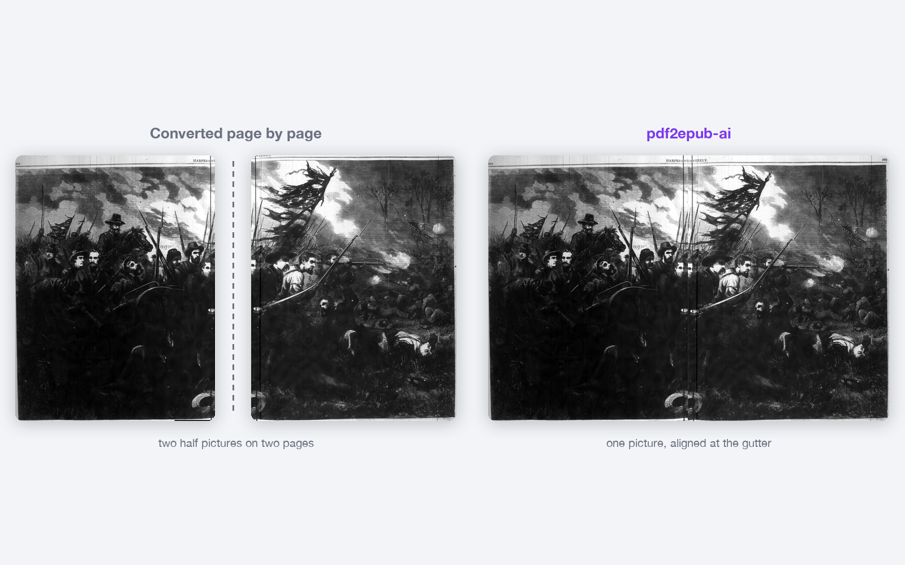
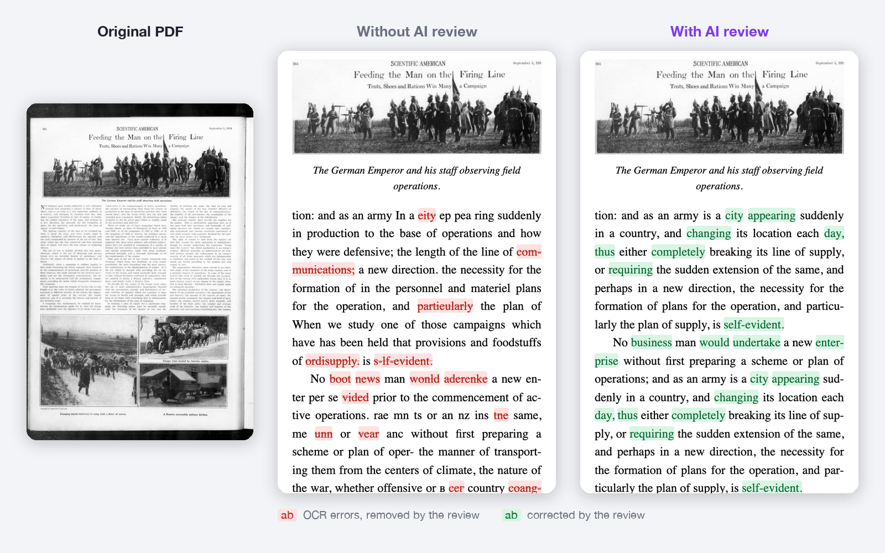

<p align="center">
  
</p>

<p align="center">
  <b>Turn any PDF, digital or scanned, into a clean, reflowable EPUB&nbsp;3.</b><br>
  Fast vision tools do the heavy lifting; an optional vision LLM checks every page against the original.
</p>

<p align="center">
  <a href="LICENSE"></a>
  
  
  
  <a href="CONTRIBUTING.md"></a>
</p>

<p align="center">
  <a href="#quick-start">Quick start</a> ·
  <a href="#sample-conversions">Samples</a> ·
  <a href="#install">Install</a> ·
  <a href="#tutorial-web-app">Web app</a> ·
  <a href="#tutorial-command-line">Command line</a> ·
  <a href="#connecting-an-ai-model">AI models</a> ·
  <a href="#contributing">Contributing</a>
</p>

---

## Why pdf2epub-ai

Convert PDFs (born-digital or scanned) into **reflowable EPUB 3** books that read well on a phone,
tablet or e-reader. Fast deterministic vision tools do most of the work; an optional vision LLM (any
OpenAI-compatible API, local or cloud) checks each page against its image and fixes what they missed.
Use it **in the browser** (`pdf2epub ui`) or **from the terminal** (`pdf2epub run`).

Built for the cases other converters get wrong:

| the problem | what pdf2epub-ai does |
|---|---|
| pictures placed anywhere, text wrapping around them | detects the page layout first, keeps pictures and captions in reading order |
| a picture printed across **two facing pages** (spread), incl. scans that lost the gutter | registers both halves and stitches them only when the seam provably matches; otherwise the LLM decides |
| **mixed scripts** (e.g. English with Arabic verses, inline honorific glyphs) | OCR per line with the right script model, `lang`/`dir` on RTL runs, embedded fonts |
| running headers/footers, page numbers, side tabs and background photos leaking into text | removed, with print page numbers kept as EPUB page-list markers |
| scanned books whose hidden OCR layer is poor (`M uham m ad`, `com plete`) | treats the hidden layer as a hint only and re-reads the page |

## Features

- **Two ways to use it** — a browser app with guided setup, a queue and pause/resume, or a
  scriptable CLI with live progress.
- **Hardware-aware OCR** — PaddleOCR with the CUDA build matching your NVIDIA driver (or CPU), and
  Apple's Vision framework on the Neural Engine on a Mac.
- **Optional AI page review** — any OpenAI-compatible vision model (llama.cpp, LM Studio, Ollama,
  OpenAI, Gemini, OpenRouter, DeepSeek…) compares every page with the original and returns
  *validated edit operations*. It never writes markup or invents text.
- **Real EPUB 3** — chapters instead of PDF pages, linked footnotes, print page numbers, embedded
  fonts for scripts readers often lack, validated with epubcheck.
- **Resumable** — progress is saved after every page; pause, lose power or lose the AI server and
  carry on later.
- **Runs anywhere** — Linux, macOS, Windows (native or WSL2), or one Docker image with GPU support.

## Sample conversions

**A picture printed across two facing pages** becomes one picture in the EPUB. Both halves are
registered (shift, scale, rotation) and placed side by side at the gutter; if the seam continuity
is proven they are stitched seamlessly. No AI needed for this one.

<p align="center">
  
</p>

When the seam can't be proven (here, a dark 1900 engraving), the halves stay apart unless the AI
review looks at both pages and confirms they are one picture:

<p align="center">
  
</p>

**Fixing what OCR misread.** Scanned magazine pages from 1914 and 1920, shown the way a phone
displays the EPUB. The middle column is the fast pipeline alone (`--no-llm`); the right column adds
the AI page review, here with a small, heavily quantized local model on llama.cpp. Red marks misread
words, green marks what the review corrected after comparing the text with the page image.

<p align="center">
  
</p>

**Headline and opening fixed.** *"Kill in ga Bear"* becomes *"Killing a Bear"*, and the garbled
*"TTovera slant hidden away"* becomes *"It was a small power plant hidden away"*.

<p align="center">
  
</p>

**Poor print, readable text.** *"No boot news man wonld aderenke a new enter per se"* becomes
*"No business man would undertake a new enterprise"*.

<p align="center">
  
</p>

**Names and the first sentence fixed.** *"How Frank Gil br eth studies men"* becomes
*"How Frank Gilbreth studies men"*, and *"Uilbreth I hed rith"* becomes *"UNTIL I talked with Frank B. Gilbreth"*.

<sub>Pages from *Harper's Weekly*, 18 June 1864 and 7 July 1900, *Popular Science Monthly*,
December 1920, and *Scientific American*, 5 September 1914 (all public domain), digitized by the
Internet Archive ([1](https://archive.org/details/sim_harpers-weekly_harpers-weekly_1864-06-18_8_390),
[2](https://archive.org/details/sim_harpers-weekly_harpers-weekly_1900-07-07_44_2272),
[3](https://archive.org/details/sim_popular-science_1920-12_97_6),
[4](https://archive.org/details/sim_scientific-american_1914-09-05_111_10)).
Rebuild these images with `scripts/readme_samples.py`.</sub>

## Quick start

```bash
# needs uv (https://docs.astral.sh/uv/) and Node.js 22.12+, see Install for details
uv tool install --python 3.11 "pdf2epub @ git+https://github.com/tajirhas9/pdf2epub-ai"
```

**In the browser**

```bash
pdf2epub ui
```

Follow the setup (about a minute), drop a PDF on the page, press **Convert to EPUB**, then
**Download EPUB**.

**In the terminal**

```bash
pdf2epub init                      # once: AI model (or none), API key, default languages and folder
pdf2epub run book.pdf              # → book.epub in the current folder
pdf2epub run book.pdf --no-llm     # fastest: no AI review (fine for clean digital PDFs)
```

## Contents

- [Install](#install) — requirements, step by step, [Docker](#docker)
- [Tutorial: web app](#tutorial-web-app) — first-run setup, converting a book
- [Tutorial: command line](#tutorial-command-line) — `run`, step by step with the workbench, [all commands](#all-commands)
- [Connecting an AI model](#connecting-an-ai-model) — providers, keys, tips for local models
- [Performance](#performance) — measured speed, local vs cloud, estimates
- [Configuration](#configuration) — config file, environment variables, where files live
- [Pause & resume](#pause--resume)
- [Troubleshooting](#troubleshooting)
- [Update & uninstall](#update--uninstall)
- [How it works](#how-it-works)
- [Development](#development) · [Contributing](#contributing) · [License](#license)

---

## Install

### What you need

| | needed for | |
|---|---|---|
| [uv](https://docs.astral.sh/uv/) (or pipx) | installing the tool; brings its own Python 3.11 | **required** |
| [Node.js](https://nodejs.org) ≥ 22.12 | building the EPUB | **required** |
| NVIDIA GPU + recent driver | fast OCR (well under 1 s per page) | optional — CPU works, ~5–8 s per scanned page |
| Java (any current JRE) | validating EPUBs with epubcheck | optional |
| ~1 GB disk | OCR models (~250 MB, downloaded on first use), build tools | |

Linux, macOS and Windows (natively or in WSL2) are supported. Or skip all of this and use
[Docker](#docker).

### Step 1 — install uv, Node.js (and optionally Java)

```bash
# Linux / macOS / WSL
curl -LsSf https://astral.sh/uv/install.sh | sh
# Node.js 22+: https://nodejs.org (or `nvm install 22`, `brew install node`, your package manager)
# Java (optional): `sudo apt install default-jre-headless` · `brew install openjdk`
```

```powershell
# Windows (PowerShell)
powershell -ExecutionPolicy ByPass -c "irm https://astral.sh/uv/install.ps1 | iex"
winget install OpenJS.NodeJS.LTS
winget install EclipseAdoptium.Temurin.21.JRE   # optional, for validation
```

Open a new terminal afterwards so `uv` and `node` are on your `PATH` (`node --version` should print
v22.12 or newer).

### Step 2 — install pdf2epub

```bash
uv tool install --python 3.11 "pdf2epub @ git+https://github.com/tajirhas9/pdf2epub-ai"
```

The OCR engine (PaddlePaddle) is installed on first use, picked for your hardware: an NVIDIA GPU gets
the CUDA build that matches its driver (12.9, 12.6 or 11.8; Linux and Windows), everything else gets
the CPU build. Paddle has no pip build for AMD, Intel or Apple GPUs, so those run on the CPU.
`pdf2epub install-paddle` does it right away (`--cpu` / `--gpu` to override, `--reinstall` to pick
again, e.g. after a driver update); `PDF2EPUB_NO_AUTO_INSTALL=1` turns the automatic install off.

**On a Mac** (Apple silicon or Intel), text recognition uses Apple's built-in Vision framework instead:
nothing to download, and on Apple silicon it runs on the Neural Engine (~0.3 s per page). Setup
(`pdf2epub init` or the web app) picks it automatically. Scripts Vision can't read (Hindi, Tamil, Greek,
Hebrew…) still go to PaddleOCR, and page layout always uses Paddle. Switch with
`pdf2epub config set ocr_engine paddle` (or `apple` / `auto`), `--ocr-engine` per run, or in Settings.

<details>
<summary>Other install options: pick the Paddle build yourself, PyPI, wheels</summary>

Prefer to choose yourself? The extras still work: `"pdf2epub[cpu] @ …"`, or `"pdf2epub[gpu] @ …"` with
`--index paddle=https://www.paddlepaddle.org.cn/packages/stable/cu129/ --index-strategy unsafe-best-match`.
Once it is on PyPI the shorter form works: `uv tool install --python 3.11 pdf2epub`.
From a downloaded or self-built wheel: `uv tool install --python 3.11 "pdf2epub-0.1.0-py3-none-any.whl"`
(build one with `uv build --wheel` in a checkout).

</details>

### Step 3 — check it

```bash
pdf2epub --version
pdf2epub ui          # opens the web app; its first-run setup checks everything above
```

### Docker

<details>
<summary>Build and run the image</summary>

Everything included (Python, Paddle, Node, Java, browser). GPU via `--gpus all`
([NVIDIA Container Toolkit](https://docs.nvidia.com/datacenter/cloud-native/container-toolkit/) needed).

```bash
docker build -t pdf2epub .                        # GPU image; --build-arg PADDLE=cpu for a CPU image

# web app on http://localhost:8765 (the link with the access key is printed in the log)
docker run --rm -it --gpus all --user "$(id -u):$(id -g)" -p 8765:8765 \
  -v pdf2epub-cache:/cache -v pdf2epub-config:/config -v "$PWD:/data" \
  pdf2epub ui --host 0.0.0.0 --no-open

# command line
docker run --rm -it --gpus all --user "$(id -u):$(id -g)" \
  -v "$PWD:/data" -v pdf2epub-cache:/cache \
  -e LLM_BASE_URL -e LLM_MODEL -e LLM_API_KEY \
  pdf2epub run book.pdf -o /data
```

`--user` keeps output files owned by you; the `pdf2epub-cache` volume keeps the downloaded models
between runs. To reach an LLM server on the host use `http://host.docker.internal:<port>/v1` (some
local servers reject that host name with HTTP 403 until it is added to their allowed hosts;
`pdf2epub llm-check` shows the server's message).

</details>

---

## Tutorial: web app

```bash
pdf2epub ui                 # --port 8765 · --no-open · --host 0.0.0.0 (Docker / other machines)
```

It prints a link like `http://localhost:8765/?t=…` and opens it. The `t=` part is a private access
key for this run: anyone who has the link can use the app, so don't share it. Stop the app with
**Ctrl+C**.

### 1. First-run setup

Shown automatically the first time (and any time from **Settings → Run first-time setup again**).

1. **Check this computer** — Node.js, OCR engine, graphics card, OCR models, Java. Items marked ✕
   must be fixed before continuing; install what's missing and press **Check again** (no restart).
2. **AI page review** — *Yes* uses a vision model to compare every page with the original and fix
   OCR mistakes, join two-page pictures and read special marks. *No* is fastest and fine for clean,
   born-digital PDFs. You can still switch per book later.
3. **Connect a model** (only if you chose *Yes*) — pick a provider (llama.cpp, LM Studio, Ollama,
   OpenAI, Gemini, OpenRouter, DeepSeek, or any OpenAI-compatible address), paste the API key if the provider
   needs one, choose a model from the list the server offers, and press **Test connection**: it sends
   one small test image and tells you whether the key, the model and image reading work.
4. **Defaults** — the languages you usually convert (faster, more accurate OCR; leave empty to
   auto-detect) and the folder EPUBs are saved to.

### 2. Convert a book

1. **Choose a PDF** — drag it onto the page or click *browse your files*. The page count and title
   appear; **Replace** or **✕** to change it.
2. **Options** (pre-filled from Settings):
   - **Languages in the book** — add each language the book uses (e.g. English + Arabic).
   - **AI page review** — on/off, and *Pages that need it* (default; skips pages the converter is
     already sure about) or *Every page* (slowest, most thorough).
   - **File name** — defaults to the PDF's name; saved in the output folder shown below it.
   - **Advanced** — use the GPU, OCR engine (Apple Vision on a Mac / PaddleOCR), text-line detector (fast/accurate/automatic), render resolution for
     digital PDFs, keep intermediate files (for inspecting pages with `pdf2epub dev`).
3. **Convert to EPUB** — the book appears under **Conversions** with the current step, a progress
   bar and the elapsed time. *Show all steps* lists every step with its timing and findings.
   The first conversion downloads the OCR models (~250 MB, once); the card says so while it waits.
4. When it's done: **Download EPUB**, or open it from the folder shown under *Saved to*.
   *Worth a look* lists places a careful reader may want to check (e.g. a two-page picture whose
   gutter was lost in the scan).

Good to know:

- You can queue several books; they run one after another. The OCR models stay loaded between books.
- **Refreshing or closing the tab doesn't stop anything.** Reopen the page and running conversions
  are still there; a chosen-but-not-converted PDF and its options are restored after a refresh.
  After closing the browser completely, open the link from the terminal again.
- **Stop** ends a conversion within moments (an AI request already sent finishes first). A failed or stopped book has
  **Convert again**: the fast steps rerun, AI review answers already received are reused.
- Uploaded PDFs are copied into the work folder and deleted after a successful conversion and when
  the app stops. Your original file is never changed.
- **Settings** has everything from the setup plus advanced model options (parallel requests,
  max reply length, timeout, extra request fields/headers). It edits the same file as
  `pdf2epub config`, and warns when an environment variable overrides a value.

### WSL, other machines, Docker

- **WSL**: the app opens in your Windows browser. If Windows can't reach `localhost` in your WSL
  setup, it shows and opens the WSL address (e.g. `http://172.x.x.x:8765/`) instead.
- **Another machine / Docker**: start with `--host 0.0.0.0` and open the printed link with the
  machine's address instead of `localhost`.

---

## Tutorial: command line

### First run

```bash
pdf2epub init          # interactive: provider, address, API key, model, default languages and folder
pdf2epub llm-check     # tests the key, the model, image reading and structured output
```

`init` without an AI model: choose *No LLM*. Non-interactive:
`pdf2epub init --provider openai --model <id> --api-key-env OPENAI_API_KEY --yes`.

### Convert a book

```bash
pdf2epub run book.pdf                         # convert → AI review → build → validate → clean up
pdf2epub run book.pdf --langs en,ar           # language hints: faster, more accurate OCR
pdf2epub run book.pdf --no-llm                # skip the AI review (fastest)
pdf2epub run book.pdf -o ~/Books              # into a folder
pdf2epub run book.pdf -o ~/Books/title.epub   # exact file name
pdf2epub run scans/                           # a folder of page images (png, jpg, tif…) works too
pdf2epub run book.pdf --keep-work             # keep intermediates to inspect them afterwards
```

| option | meaning | default |
|---|---|---|
| `--langs en,ar` | languages in the book (ISO codes) | auto-detect (slower) |
| `--llm` / `--no-llm` | AI page review | from config (`llm.enabled`, on) |
| `-o`, `--output` | output folder, or exact `.epub` path | current folder (`out/` in a checkout) |
| `--keep-work` | keep intermediate files after success | removed |
| `-v` (before the command) | library logs and a timing table | off |

The terminal shows one line per step with progress and findings, then a summary box:

```
pdf2epub 0.1.0  sample.pdf
14 pages · languages en, ar · LLM qwen3.8-flash-next-iq2_xs @ localhost:8080

✓ Connect to LLM                                   0.1s   qwen3.8-flash-next-iq2_xs
✓ Load vision models                               27.0s  GPU
✓ Read pages                                 14/14 0.3s   scanned, 150 ppi
✓ Recognize text                             14/14 5.0s   OCR on all pages, 3 right-to-left blocks
✓ Remove headers & page numbers                    0.0s   31 removed · printed pages 31–44
✓ Join two-page spreads                            0.8s   2 joined, 1 uncertain (LLM decides)
⠹ LLM: review pages      ━━━━━━━━━━──────     9/14 1m 12s  ~40s left  83 fixes · 7 rejected
```

In pipes and CI the output is one plain line per step. After a successful build the intermediate
files are deleted; after a failure they are kept, and AI review answers are reused by the next run.

### Step by step, checking pages in the browser

For difficult books: convert, look at every page next to the original, let the AI review, build.

```bash
pdf2epub convert book.pdf --langs en,ar --no-llm   # pages + text + pictures, no EPUB yet
pdf2epub dev                                      # workbench: original | phone | tablet | two-page views
pdf2epub review                                   # AI review; pages update live in the workbench
pdf2epub build -o ~/Books                         # EPUB + validation, then clean up
```

- `--pages 1-20,25` (convert/review) limits the work to some pages; `--from-stage <stage>` resumes
  from a checkpoint (stages: rasterize, layout, text, running, figures, spreads, order, glyphs).
- `review --policy all` reviews every page instead of only flagged ones.
- `dev`/`review`/`build` use the most recent book; pick another with `--book <id or pdf path>`.
- Pages you edit by hand in the workbench (`work/<book>/pages/*.vue`) are detected and kept.
- `pdf2epub clean <book>` or `clean --all` deletes intermediates.

### All commands

| command | what it does |
|---|---|
| `pdf2epub ui` | web app: setup, settings, convert in the browser |
| `pdf2epub run PDF` | one shot: convert → review → build |
| `pdf2epub convert PDF` | prepare pages (no EPUB) |
| `pdf2epub dev` | page workbench in the browser |
| `pdf2epub review` | AI review of a converted book |
| `pdf2epub build` | make and validate the EPUB |
| `pdf2epub init` | first-run setup in the terminal |
| `pdf2epub llm-check` | test the AI model connection |
| `pdf2epub install-paddle` | install the best PaddlePaddle build (OCR engine) for this computer |
| `pdf2epub config show/set/unset/path` | view and change settings |
| `pdf2epub clean` | delete intermediate files |
| `pdf2epub uninstall` | remove models, caches, settings and the stored API key |
| `pdf2epub eval` / `schema` | development: quality corpus, IR schema |

`pdf2epub <command> --help` shows every option.

---

## Connecting an AI model

Any OpenAI-compatible endpoint with a **vision** model works. Set it up in the web app
(**Settings → AI page review**), with `pdf2epub init`, or with `config set`:

| provider | address (`llm.base_url`) | API key |
|---|---|---|
| llama.cpp server | `http://localhost:8080/v1` | not needed |
| LM Studio | `http://localhost:1234/v1` | not needed |
| Ollama | `http://localhost:11434/v1` | not needed |
| OpenAI | `https://api.openai.com/v1` | required |
| Google Gemini | `https://generativelanguage.googleapis.com/v1beta/openai/` | required |
| OpenRouter | `https://openrouter.ai/api/v1` | required |
| DeepSeek | `https://api.deepseek.com` (model `deepseek-flash`) | required |

```bash
pdf2epub config set llm.base_url https://openrouter.ai/api/v1
pdf2epub config set llm.model <vision-capable model id>
pdf2epub config set llm.api_key <key>      # stored in the OS keyring when available
pdf2epub llm-check
```

Tips:

- **Local servers with one slot**: `pdf2epub config set llm.concurrency 1`.
- **Reasoning ("thinking") models** are much slower for this job. Turn thinking off with extra
  request fields — Qwen on llama.cpp/vLLM: `config set llm.extra_body '{"chat_template_kwargs": {"enable_thinking": false}}'`;
  OpenAI/Gemini: `config set llm.extra_body '{"reasoning_effort": "low"}'`. (In the web app:
  Settings → Advanced model options → Extra request fields.)
- `llm.max_output_tokens` (default 4096) stops runaway answers from small models.
- The client adapts to the server (structured output json_schema → json_object → prompt-only, drops
  rejected parameters, retries 429/5xx honoring `Retry-After`) and caches answers. Keys are never logged.

---

## Performance

Measured on the sample books above (scanned magazine pages, 200 dpi) on an Apple M3 Pro with Apple
Vision OCR. Your numbers will differ with hardware, page size and model.

**Without AI review** (`--no-llm`):

| pages | time per page |
|---|---|
| scanned text pages with pictures | ~2.5–4 s |
| scanned pages with two-page spreads (registration and seam check) | ~13–25 s |

With an NVIDIA GPU the OCR step drops well under 1 s per page; on CPU-only Paddle expect ~5–8 s per
scanned page.

**With AI review, measured.** One page review sends the page image, zoomed crops and the page text
(~2.5–7k prompt tokens) and gets back edit operations (~150–1,400 output tokens).

| model | where | prompt read | output | time per page |
|---|---|---|---|---|
| Qwen 3.8 flash, IQ2_XS (small, heavily quantized) | llama.cpp-type server, RTX 5070 Ti, 1 slot | 80–125 tok/s | 25–30 tok/s | **70–110 s** |
| DeepSeek `deepseek-flash`, thinking off | cloud API | — | — | **~3 s** |

On the local server about 60% of the time is spent reading the prompt: requests with images are not
served from the prompt cache, so every page pays the full prefill. A 300-page scan takes 6–9 hours
there; [pause & resume](#pause--resume) is built for that.

**With AI review, estimated for cloud APIs.** Frontier cloud models are not benchmarked here; this is
the arithmetic for a typical page of ~5k prompt and ~800 output tokens, thinking off:

```
seconds per page ≈ prompt tokens / prompt speed + output tokens / output speed + ~1 s latency
```

| output speed | prompt speed | per page | 300 pages, `llm.concurrency 1` | `llm.concurrency 4` |
|---|---|---|---|---|
| 50 tok/s | ~1,000 tok/s | ~22 s | ~1 h 50 min | ~30 min |
| 100 tok/s | ~2,000 tok/s | ~11 s | ~1 h | ~15 min |
| 200 tok/s | ~3,000 tok/s | ~6 s | ~35 min | ~8 min |

- **Thinking multiplies the output.** On a 656-page scan with DeepSeek thinking on, ~90% of output
  tokens were hidden reasoning (cost $2.37). Turn it off (see [tips](#connecting-an-ai-model)).
- **Concurrency helps cloud APIs**, up to the provider's rate limit. Keep `llm.concurrency 1` for
  one-slot local servers.
- **Fewer pages, less time.** The default `llm.review_policy flagged` skips pages the fast pipeline
  is sure about; on scans most pages are flagged, on clean digital PDFs few are.
- Every request's time and token counts are written to `work/<book>/llm/usage.jsonl`. Review a few
  pages of your book to get your own per-page number.

---

## Configuration

Settings come from (highest first): **command-line flags** → **environment variables**
(`LLM_*`, `PDF2EPUB_*`) → **`./pdf2epub.toml`** in the current folder → **user config file**
(written by `init`, `config set` and the web app) → defaults.

```bash
pdf2epub config show            # the config file (secrets hidden)
pdf2epub config show --all      # effective value of every setting
pdf2epub config set langs en,ar
pdf2epub config unset langs
pdf2epub config path
```

Example config file:

```toml
langs = ["en", "ar"]
out_dir = "~/Books"

[llm]
base_url = "https://openrouter.ai/api/v1"
model = "<vision-capable model id>"
concurrency = 4

[llm.extra_body]
reasoning_effort = "low"
```

<details>
<summary>All settings and their environment variables</summary>

| setting | env variable | default | meaning |
|---|---|---|---|
| `langs` | `PDF2EPUB_LANGS` | auto | language hints, e.g. `["en","ar"]` |
| `out_dir` | `PDF2EPUB_OUT_DIR` | current folder | where EPUBs go |
| `keep_work` | `PDF2EPUB_KEEP_WORK` | false | keep intermediates after success |
| `use_gpu` | `PDF2EPUB_USE_GPU` | true | use an NVIDIA GPU when present |
| `ocr_engine` | `PDF2EPUB_OCR_ENGINE` | auto | text recognition: `apple` (Apple Vision, macOS) / `paddle`; auto = Apple Vision on a Mac |
| `ocr_det_model` | `PDF2EPUB_OCR_DET_MODEL` | auto | text-line detector (`PP-OCRv5_mobile_det` / `_server_det`) |
| `vector_dpi` | `PDF2EPUB_VECTOR_DPI` | 200 | render resolution for digital PDFs |
| `workers` | `PDF2EPUB_WORKERS` | 0 (all cores) | parallel page workers |
| `llm.enabled` | `LLM_ENABLED` | true | AI review by default |
| `llm.base_url` | `LLM_BASE_URL` | `http://localhost:8080/v1` | endpoint |
| `llm.model` | `LLM_MODEL` | server default | model id |
| `llm.api_key` | `LLM_API_KEY` | none | key (keyring when available) |
| `llm.review_policy` | `LLM_REVIEW_POLICY` | flagged | `flagged` · `all` · `none` |
| `llm.concurrency` | `LLM_CONCURRENCY` | 2 | parallel requests |
| `llm.max_output_tokens` | `LLM_MAX_OUTPUT_TOKENS` | 4096 | reply length cap |
| `llm.timeout_s` | `LLM_TIMEOUT_S` | 300 | per request |
| `llm.extra_body` | `LLM_EXTRA_BODY` | `{}` | provider-specific request fields (JSON) |
| `llm.extra_headers` | `LLM_EXTRA_HEADERS` | `{}` | extra HTTP headers (JSON) |
| `llm.json_mode` | `LLM_JSON_MODE` | auto | `auto` · `json_schema` · `json_object` · `prompt` |

</details>

Where files live:

| | installed tool | git checkout |
|---|---|---|
| config | `~/.config/pdf2epub/config.toml` (macOS `~/Library/Application Support/pdf2epub`, Windows `%APPDATA%\pdf2epub`) | `.pdf2epub.toml`, `.env`, `.env.local` in the repo |
| models, browser, epubcheck, build tools, work files | `~/.cache/pdf2epub/` | `.cache/`, `web/node_modules`, `work/` in the repo |
| default output | current folder | `out/` |
| API key | OS keyring (fallback: config file, readable only by you) | `.env.local` or keyring |

---

## Pause & resume

Long AI reviews can take hours on a local model. Progress is saved after every page, so nothing is
lost when you pause, when the computer loses power, or when the AI server stops.

- **Terminal:** press **Ctrl+C** once to pause after the current page (press it twice to stop at
  once; the saved pages are kept either way). To continue, run the same command again:
  `pdf2epub run book.pdf` picks up where it stopped (`Resuming: stopped during LLM: review pages
  (143/400 pages done)`). To start over, add `--restart`.
- **Web app:** use **Pause** and **Resume** on the conversion card. If the app or the computer
  stopped mid-conversion, the job shows up as *Interrupted* the next time you start `pdf2epub ui`.
  Press **Resume** to continue. **Remove** discards the saved progress.
- **AI server stops answering** (crashed, unloaded, unreachable): the conversion pauses on its own
  (exit code 75 in the terminal) instead of skipping the remaining pages. Start the server again,
  then resume.

The saved progress belongs to that PDF and those options (languages, GPU, AI review on/off,
review policy). Changing one of them in the terminal asks for `--restart`. Uploading the same
PDF again in the web app continues its progress.

---

## Troubleshooting

| problem | fix |
|---|---|
| `Node.js >= 22.12 is needed` / setup shows ✕ Node.js | install Node 22+, open a new terminal, *Check again* |
| `PaddlePaddle is not installed` / ✕ OCR engine | `pdf2epub install-paddle` (or *Try again* in the web app); `--cpu` if the GPU build fails |
| GPU not used | update the NVIDIA driver (check `nvidia-smi`), then `pdf2epub install-paddle --reinstall`. In Docker add `--gpus all` |
| `cannot reach the LLM at …` | is the server running? right address and port? `pdf2epub llm-check`; or convert with `--no-llm` |
| HTTP 401/403 from the model | wrong or missing API key; for local servers in Docker see [Docker](#docker) |
| AI review very slow | turn off "thinking" (see [tips](#connecting-an-ai-model)), `llm.concurrency 1` for one-slot local servers, or review only flagged pages; see [Performance](#performance) |
| "not validated" after a build | install Java to enable epubcheck; the EPUB is still built |
| `npm ci failed` on first use | the first build installs the EPUB build tools (needs internet once) |
| first conversion is slow | the OCR models download once (~250 MB) |
| web app link says "from an earlier run" | the access key changes on every start: use the newest link from the terminal |
| WSL: page doesn't open in Windows | use the WSL address the terminal prints (`http://172.x.x.x:…`) |

`-v` (e.g. `pdf2epub -v run book.pdf`) prints full logs and tracebacks.

---

## Update & uninstall

```bash
uv tool upgrade pdf2epub                        # or reinstall with the same command as Step 2
pdf2epub uninstall                              # models, caches, work files, settings, stored API key
uv tool uninstall pdf2epub                      # the program itself
```

---

## How it works

```
PDF ─ rasterize ─ layout ─ text ─ running ─ figures ─ spreads ─ order ─▶ IR (JSON)
                                                                         │ codegen
LLM review (validated edit ops on IR) ◀── page image + zoomed crops ──── work/<book>/pages/p0001.vue …
                                                                         │ vite build --mode epub
                                                       out/<book>.epub ◀─ SSR → chapter XHTML → OPF/nav → zip → epubcheck
```

- **IR is the source of truth.** Vue pages are generated from it; the LLM never writes markup.
  It returns edit operations (`fix_text`, `set_role`, `reorder`, …) that are validated (no
  invented text, no unknown blocks, similarity guards) before being applied. Hand-edited `.vue`
  pages are detected and locked.
- **Layout before OCR** (PaddleOCR PP-DocLayout + PP-OCRv5): OCR runs per line with the right
  script model; good text layers skip OCR entirely; a hidden OCR layer is only a hint.
- **Spreads**: halves are registered (shift, scale, overlap, rotation) and stitched only when the
  seam continuity is proven. Otherwise the aligned halves become a candidate that the LLM confirms
  by looking at both pages; content lost in the binding is never invented.
- **Glyphs**: inline special marks OCR misreads (honorifics, dingbats) are cropped, clustered, and
  resolved once per distinct glyph by the LLM, then applied book-wide.
- **Fonts**: an OFL font is embedded for scripts readers often lack (Arabic: Amiri).
- **EPUB**: PDF pages are a dev unit only; the build merges them into chapters, keeps print page
  numbers as `pagebreak` markers (page-list), links footnotes, marks RTL runs with `lang`/`dir`.
- **Web app**: a small standard-library HTTP server (`src/pdf2epub/webui`) runs the same pipeline as
  the CLI in one worker thread; the page is a Vue app (`web/src/ui`) shipped pre-built in the wheel.

---

## Development

```bash
git clone https://github.com/tajirhas9/pdf2epub-ai && cd pdf2epub-ai
scripts/setup.sh              # .venv + best Paddle build for this machine + web/node_modules + epubcheck, all in the repo
uv run pdf2epub init          # writes .pdf2epub.toml (gitignored); or copy .env.example to .env.local
uv run pdf2epub llm-check
```

Everything heavy lives inside the project (`.venv`, `.cache`, `web/node_modules`, `work/`); in a
checkout prefix commands with `uv run`.

```bash
uv run pytest                 # unit + end-to-end (synthetic PDF → EPUB → epubcheck) + web backend
uvx ruff check src tests      # lint (config in pyproject)
cd web && npm run typecheck
uv run pdf2epub eval          # corpus evaluation, flags regressions vs the previous run (eval/README.md)
```

Web-app hot reload, release builds, the Paddle/`uv sync` interplay and the project rules are in
[CONTRIBUTING.md](CONTRIBUTING.md#development-setup).

---

## Contributing

Contributions are welcome: bug reports, test documents that break the converter, docs and code.

- Read [CONTRIBUTING.md](CONTRIBUTING.md) for setup, checks and the pull-request flow.
- Commits are signed off (`git commit -s`), and contributions come with a
  [license grant](CONTRIBUTING.md#licensing-of-contributions) to the project owner.
- Be kind: [Code of Conduct](CODE_OF_CONDUCT.md).
- Found a security problem? Report it privately, see [SECURITY.md](SECURITY.md).

## License

pdf2epub-ai is **source-available** under the [PolyForm Noncommercial License 1.0.0](LICENSE).

- ✅ Free for **noncommercial** use: personal projects, hobby, study, research, education, and use by
  charities, schools, public research and government bodies.
- ✅ You may modify it and share your changes under the same license (keep the `Required Notice`).
- ❌ **Commercial use needs written permission.** For a commercial license, contact
  [tajircuet@gmail.com](mailto:tajircuet@gmail.com) or [tajirhasnain.com](https://tajirhasnain.com).

The license text is authoritative; this summary is not legal advice.

## Acknowledgements

pdf2epub-ai builds on [PaddleOCR](https://github.com/PaddlePaddle/PaddleOCR) (Apache-2.0),
[PyMuPDF](https://github.com/pymupdf/PyMuPDF) (AGPL-3.0), Apple's
[Vision](https://developer.apple.com/documentation/vision) framework, [Vue](https://vuejs.org) and
[Vite](https://vite.dev) (MIT), [epubcheck](https://github.com/w3c/epubcheck) (BSD-3-Clause) and the
[Amiri](https://github.com/aliftype/amiri) font (OFL-1.1). Each keeps its own license.
Sample pages are from public-domain magazines digitized by the [Internet Archive](https://archive.org).

---

Developed by [tajirhas9](https://tajirhasnain.com) · [Source on GitHub](https://github.com/tajirhas9/pdf2epub-ai)
